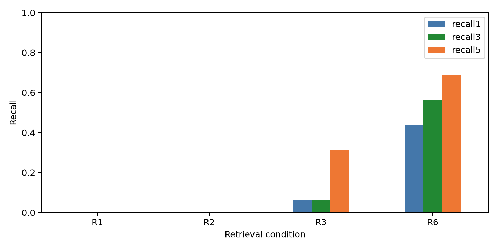

# E3 检索（K5）

## 2026-10-10 M3 格式修复后正式重测

本节使用冻结标签 `knowledge-e3-freeze-v2.4.1`，平台提交为 `f55249d3`，数据提交为 `ea11a85e`，manifest 哈希为 `3e536a77fb0724316e10fee1bf9d0d409f88caf57b13e0a7a189c9a339950137`，配置哈希为 `ed17dd1be028bcb8d50bbca6dc21097da30b237684303512847bb723c2b5b1b3`。模型调用统一为 `minimax / MiniMax-M3`。完整冻结字段见 [`freeze-e3-v2.4.1.md`](../freeze-e3-v2.4.1.md)。

M3 重排复用了 `extractFirstJsonObject`，因此接受纯 JSON 和 Markdown 代码围栏中的 JSON，同时保留字段、临时编号、数量、重复编号和候选范围校验。88 条本地比较全部完成，132 次 M3 请求中 127 次成功、5 次失败，失败率为 3.79%。失败记录保存在运行目录的 `results.jsonl`，没有计入知识质量指标。失败原因包括模型增加未声明的 `file` 字段 1 次，以及返回内容无法取得 JSON 对象 4 次。成功请求没有再因为代码围栏格式被拒绝。

### 目标卡片提供率

每个条件包含 16 个陷阱任务和 6 个对照任务，原查询与自然语言改写各执行一次本地条件、三次 M3 条件。M3 的任务多数统计会忽略失败重复；失败率单独报告。

| 查询 | 原词法与 bounded | BM25 | BM25 + M3 任务多数 | BM25 + M3 有效重复 | 对照误提供（有效重复） |
|---|---:|---:|---:|---:|---:|
| 原查询 | 5/16（31.25%） | 11/16（68.75%） | 16/16（100%） | 43/44（97.73%） | 15/18（83.33%） |
| 自然语言改写 | 5/16（31.25%） | 13/16（81.25%） | 15/16（93.75%） | 44/48（91.67%） | 12/17（70.59%） |

对照任务按预先固定的相关卡片清单计算误提供；提供清单之外的卡片记为误提供，返回任意卡片只作为辅助数据。原查询的 M3 任务多数对照误提供为 5/6，改写查询为 4/6；改写查询有一个对照任务因失败重复无法形成多数。

### 重复一致性、费用与时延

| 查询 | M3 任务多数一致的陷阱任务 | M3 任务多数一致的对照任务 | 中位墙钟时间 | P95 墙钟时间 | 平均费用/有效请求 | 总费用 |
|---|---:|---:|---:|---:|---:|---:|
| 原查询 | 15/16 | 6/6 | 14.58 秒 | 27.33 秒 | 0.01817 元 | 1.19894 元 |
| 自然语言改写 | 15/16 | 5/6 | 12.68 秒 | 21.78 秒 | 0.01546 元 | 1.02032 元 |

任务多数相对于 BM25 的配对比较使用 16 个陷阱任务。原查询由 11/16 增至 16/16，增量 31.25 个百分点，95% bootstrap 区间为 [12.50, 56.25] 个百分点，精确 McNemar 未校正 p=0.0625，Holm 校正 p=0.125，报告为方向性结果。自然语言改写由 13/16 增至 15/16，增量 12.50 个百分点，95% bootstrap 区间为 [0, 31.25] 个百分点，精确 McNemar 未校正 p=0.5，Holm 校正 p=0.5，报告为方向性结果。M3 的 5 次失败使预先声明的“无失败”采用条件未满足，因此暂不把 BM25 + M3 设为 E4 的正式主配置；当前结果支持将它列为待补充重试的候选配置。

### 失败清单

| 组合 | 失败原因 | 处理 |
|---|---|---|
| `R1-T01-original-C-1` | 返回条目包含未声明的 `file` 字段 | 严格字段校验拒绝，排除质量统计 |
| `R2-C02-paraphrase-C-1` | 无法取得 JSON 对象 | 排除质量统计 |
| `R2-T04-original-C-1` | 无法取得 JSON 对象 | 排除质量统计 |
| `R2-T05-original-C-3` | 无法取得 JSON 对象 | 排除质量统计 |
| `R2-T08-original-C-2` | 无法取得 JSON 对象 | 排除质量统计 |

失败响应的输入、输出摘要和用量保存在各自的 `raw/<组合>/response.json`。本轮没有请求超时；严格解析失败仍然保留为模型接口稳定性数据。

## 2026-10-10 重测状态

BM25 历史复现176条查询全部完成，候选排名与 v2.2 逐条相同。本轮增加最终知识段的提供评价，冻结信息见 `../freeze-e3-v2.3.1.md`，协议与查询在运行前固定。

| 查询 | bounded 目标提供 | BM25 目标提供 | bounded 对照误提供 | BM25 对照误提供 |
|---|---:|---:|---:|---:|
| 原查询 | 5/16 | 11/16 | 6/6 | 6/6 |
| 自然语言改写 | 5/16 | 13/16 | 6/6 | 6/6 |

共88次本地请求，均完成真实 HTTP、产品预览与知识段重放核验。改写保留接口要求和文件路径，每个原任务一条改写；独立任务数仍为22。本表采用最终知识段中的卡片身份，预算为单卡正文800字符、完整知识段4000字符。

对照误提供指包含至少一张预先标注相关集之外的卡片。六个对照的相关卡片清单与逐条依据已经在 `e3-retest-protocol.json` 固定，由用户确认这一统计口径。标注为单个审阅者完成，尚无独立一致率。返回任何卡片的辅助比例在这两个条件下同为6/6。

M3 比较预定132次，当前完成4次，均返回带 Markdown 代码围栏的 JSON，被严格 JSON 入口记为格式失败。4次服务端用量估算费用0.05739384元；另有一个暂停中的请求未取得响应，用量与费用未知。当前不报告 M3 选择质量或条件间显著性结论。模型重排相对 BM25 的采用判断仍待完整矩阵。

原始结果为 `experiments/knowledge/runs/E3-delivery-v231-m3/results.jsonl`，模型返回保存在同目录 `llm-calls.jsonl`，暂停状态见 `interruption.json`。复用现有 `extractFirstJsonObject` 的格式适配与新冻结版本等待用户确认。

## v2.2 BM25 比较结果

冻结标签 `knowledge-exp-freeze-v2.2`，平台提交 `efda9418f5aefa18780891f2619e154381491fb4`，数据提交 `ea11a85ed344c522fe3b63288cd8577c94fa6498`。manifest SHA-256 为 `3e536a77fb0724316e10fee1bf9d0d409f88caf57b13e0a7a189c9a339950137`，基础配置哈希为 `1251aac44831146db92c9adb574fedb933cfcc2928164e6ec8f5ded51540d0ef`，完整比较协议哈希为 `289e9e47ce5b4de215680a7098930a36099d5bde3927cff54ab149a9d065fb92`。版本与文件哈希见 [freeze-v2.2.md](../freeze-v2.2.md)。本节为新增检索方式的完整比较；下文保留 v2.1 基线和 v2 试跑。

### 小规模比较与采用标准

在完整比较前固定 `bm25-protocol.json`：选择 R1-T01、R1-T08、R2-T01、R2-T08 四个陷阱，以及 R1-C01、R2-C01 两个对照；执行五种条件，共30条查询。采用标准为 R6 的 Recall@5 高于 R3、MRR 不降低、对照误注入数量不增加。参数、提示、卡片与目标标注在比较后保持原值。

| 条件 | Recall@1 | Recall@3 | Recall@5 | MRR | nDCG@5 | 对照误注入数 / 2查询 |
|---|---:|---:|---:|---:|---:|---:|
| R1 纯词法 | 0% | 0% | 0% | 0.0390 | 0 | 10 |
| R2 legacy | 0% | 0% | 0% | 0.0390 | 0 | 10 |
| R3 bounded | 25% | 25% | 25% | 0.3031 | 0.2500 | 10 |
| R6 MiniSearch BM25+ 与 bounded 文件加分 | 25% | 25% | 50% | 0.3729 | 0.3467 | 10 |
| R6-lexical MiniSearch BM25+ | 25% | 25% | 50% | 0.3729 | 0.3467 | 10 |

达到预先声明的采用标准。试跑结果位于 `experiments/knowledge/runs/E3-bm25-pilot-20261010/`，协议对象哈希为 `83c9a4f87604fb84e5830cf402e43e9d89d5bf597ad332c8a0b5a5d628b2f950`。试跑与产品调用同一个 `searchRankedKnowledgeCards`，重现测试核验已保存的指标与目标排名。

### 检索方式与完整比较

新增配置 `lexicalScoring: "bm25"`，使用 MiniSearch 7.2.0 的 BM25+，默认参数 `k=1.2`、`b=0.7`、`d=0.5`。使用原有 `embeddingText`，包含标题、摘要、标签、正文、关联路径和首个代码快照，继续使用12000字符限制。中文使用 `Intl.Segmenter`；完整代码名称作为词语保留；查询词去重；关闭前缀与模糊匹配。MiniSearch 还会按匹配词覆盖情况调整分数，因此这里报告具体库的 BM25+ 实现。

BM25 使用相关分数作为主要排序依据，类型只决定同分次序，卡片编号决定最后的同分次序。`ranking: "bounded"` 保留最多0.06的文件加分。该方式综合改变了分词、词频与文档长度计算、查询长度处理和排序顺序；本实验评估完整检索方式的效果，各因素的单独贡献尚无实验数据。默认项目配置继续使用原词法方式；知识预览、Agent 注入和 MCP 查询均可通过配置选择 BM25。

完整比较使用16个陷阱、6个对照，每任务执行八个条件，共176条确定性查询。任务查询保留完整提示，活动文件由产品函数从提示中已有的工作区路径推导。R6-lexical 关闭活动文件；R6-wrong-file 使用同一错误文件扰动。对照任务相关集为空，Recall、MRR、nDCG 为 null，只累计前五名误注入数量。

| 条件 | 陷阱数 | Recall@1 | Recall@3 | Recall@5 | MRR | nDCG@5 | 对照误注入数 / 6查询 |
|---|---:|---:|---:|---:|---:|---:|---:|
| R1 纯词法 | 16 | 0% | 0% | 0% | 0.0368 | 0 | 30 |
| R2 legacy | 16 | 0% | 0% | 0% | 0.0368 | 0 | 30 |
| R3 bounded | 16 | 6.25% | 6.25% | 31.25% | 0.1722 | 0.1702 | 30 |
| R6 MiniSearch BM25+ 与 bounded 文件加分 | 16 | 43.75% | 56.25% | 68.75% | 0.5580 | 0.5565 | 30 |
| R6-lexical MiniSearch BM25+ | 16 | 43.75% | 56.25% | 68.75% | 0.5580 | 0.5565 | 30 |
| R2 错误文件 | 16 | 0% | 0% | 0% | 0.0368 | 0 | 30 |
| R3 错误文件 | 16 | 0% | 0% | 0% | 0.0664 | 0 | 30 |
| R6 错误文件 | 16 | 43.75% | 56.25% | 68.75% | 0.5580 | 0.5565 | 30 |



### 配对统计与未参与小规模比较的任务

主指标为 Recall@5；每个陷阱只有一张目标卡片，因此每任务结果为0或1。采用精确 McNemar、按任务配对重采样10000次的95% CI（种子20261007），并对协议中的三项主比较使用 Holm 校正。结果保存在 `analysis/statistics/retrieval-comparisons.json`。

| 比较 | 配对任务数 | Recall@5 增量 | 95% CI（百分点） | 基线单独命中 / BM25 单独命中 | 精确 McNemar p | Holm p |
|---|---:|---:|---|---:|---:|---:|
| R6 相对 R3 | 16 | 37.50个百分点 | [6.25, 62.50] | 1 / 7 | 0.0703125 | 0.0703125 |
| R6 相对 R1 | 16 | 68.75个百分点 | [43.75, 87.50] | 0 / 11 | 0.0009766 | 0.0029297 |
| R6 相对 R2 | 16 | 68.75个百分点 | [43.75, 87.50] | 0 / 11 | 0.0009766 | 0.0029297 |

相对 R3 的差异按精确检验仅报告方向性；相对 R1、R2 的差异在此构造任务集合中达到0.05。CI 与精确检验使用不同统计方法，结论以协议中的精确检验为准。

将小规模比较的六个任务排除后，另外12个陷阱、4个对照构成辅助子集：R3 Recall@5 为4/12（33.33%），R6 为9/12（75%）；R6 的 Recall@1 为50%、Recall@3 为66.67%、MRR 为0.6197。配对增量为41.67个百分点，95% CI 为[16.67, 66.67]个百分点，精确 McNemar 未校正 p=0.0625，仍为方向性。该子集为探索性辅助结果，没有加入三项主比较的 Holm 校正。这些任务已用于既有 E3 评估，此处仅按本轮试跑参与情况分组。每种条件的对照误注入数均为20/4查询。结果保存在 `analysis/statistics/retrieval-held-out.json`。

### 活动文件来源与失败清单

| 实际活动文件来源 | 陷阱数 | R3 Recall@5 | R6 Recall@5 |
|---|---:|---:|---:|
| 为空（R1 仓库） | 8 | 0/8 | 4/8 |
| 提示中已有路径（R2 仓库） | 8 | 5/8 | 7/8 |

本次没有显式上下文或发起成员当前文件来源。R6、R6-lexical、R6-wrong-file 的主要指标和目标排名均相同。BM25 正词法分范围为0.0843至3590.4303，原有0.06文件加分对本组目标排名没有作用，因此错误文件扰动未改变目标结果；不能据此推断其它任务中的文件上下文风险已经消除。

全部176条查询完成，请求超时、模型失败、判定器错误均为0。BM25 未进入前五名的目标如下；目标卡片仍在候选集合中，分数低于至少五张候选卡片。

| 任务 | 目标卡片 | R3 目标排名 | R6 目标排名 |
|---|---|---:|---:|
| R1-T02 | R1-T02-target | 15 | 8 |
| R1-T05 | R1-T05-target | 15 | 6 |
| R1-T07 | R1-T02-target | 16 | 9 |
| R1-T08 | R1-T03-target | 12 | 6 |
| R2-T01 | R2-T01-target | 1 | 8 |

R2-T01 是一条相对 R3 排名降低的记录。候选分数与前五名保存在 `missed-targets.json`，没有修改任务、目标标注或卡片文字以提高指标。对照任务仍然每次返回五张卡片，说明本次改进主要体现在目标排名，缺少“无需提供知识”的判断能力。

### 核验、复现与版本范围

`verification.json` 核验原有五个条件的110条查询，全部排名与 v2.1 完全相同；试跑30条指标与目标排名相同。另在独立目录重复完整176条查询，全部候选排名与指标相同。固定协议后没有调整参数。

```sh
pnpm --filter @simplercp/experiments exec tsx --test test/bm25.test.ts
pnpm --filter @simplercp/experiments experiment k5 \
  --config experiments/knowledge/formal-v21.json \
  --protocol experiments/knowledge/bm25-full-protocol.json \
  --conditions R1,R2,R3,R6,R6-lexical,R2-wrong-file,R3-wrong-file,R6-wrong-file \
  --out experiments/knowledge/runs/E3-k5-bm25-v22
pnpm --filter @simplercp/experiments experiment summarize \
  --config experiments/knowledge/formal-v21.json \
  --source experiments/knowledge/runs/E3-k5-bm25-v22
experiments/knowledge/analysis/.venv/bin/python \
  experiments/knowledge/analysis/analyze.py \
  experiments/knowledge/runs/E3-k5-bm25-v22/results.jsonl \
  --out experiments/knowledge/runs/E3-k5-bm25-v22/analysis/statistics
```

试跑元数据记录执行时的 HEAD `418a4ccc`，当时工作目录中已有本次新增实现；实现由 `efda9418` 冻结，试跑结果由上述回归测试重现。完整比较结果目录为 `experiments/knowledge/runs/E3-k5-bm25-v22/`；从零执行时使用冻结提交和新的输出目录，续跑检查会拒绝提交不同的目录。独立复跑耗时4.33秒（含pnpm、数据哈希校验、索引构建和写入）。模型调用0次，模型费用0元。配置中的 `minimax / MiniMax-M3` 为通用实验元数据，本项没有调用该模型，没有生成向量。

`pnpm build`、`pnpm test`（server160、knowledge162、demo2）、实验工具19项、统计工具5项、通用 E2E 24项与知识 E2E 25项通过。新增测试使用冻结卡片与真实 HTTP，覆盖长查询、完整代码名称、确定性排名、试跑重现、线上预览与离线选择一致、可见性与状态过滤。BM25 候选日志分别标注可用语料与已过滤语料的 `scoreScope`，保留可用候选的实际次序。

本节仅更新 E3。E4 已保存的114条 M3 运行继续属于 v2.1，其 C2 配置与结果保留；模型额度恢复后的 BM25 端到端验证需要使用独立配置与结果目录。当前证据支持保留 BM25 这一可选检索方式，端到端复犯率、误注入减少与真人协作效果仍没有本次实验数据。

## v2.1 正式结果

冻结标签 `knowledge-exp-freeze-v2.1`，平台提交 `418a4ccc758de803efc5427bea0b0cd09cc26dc5`，数据提交 `ea11a85ed344c522fe3b63288cd8577c94fa6498`。manifest 哈希 `3e536a77fb0724316e10fee1bf9d0d409f88caf57b13e0a7a189c9a339950137`，配置哈希 `1251aac44831146db92c9adb574fedb933cfcc2928164e6ec8f5ded51540d0ef`。

```sh
pnpm --filter @simplercp/experiments experiment k5 \
  --config experiments/knowledge/formal-v21.json \
  --out experiments/knowledge/runs/E3-k5-formal-v21-m3
```

22个任务各执行3种排序及2种错误活动文件扰动，共110条确定性查询。每条件16个陷阱用于 Recall、MRR、nDCG，6个对照仅用于误注入数量。没有模型请求。

| 条件 | Recall@1 | Recall@3 | Recall@5 | MRR | nDCG@5 | 对照误注入数 / 6查询 |
|---|---:|---:|---:|---:|---:|---:|
| R1 纯词法 | 0% | 0% | 0% | 0.0368 | 0 | 30 |
| R2 legacy | 0% | 0% | 0% | 0.0368 | 0 | 30 |
| R3 bounded | 6.25% | 6.25% | 31.25% | 0.1722 | 0.1702 | 30 |
| R2 错误文件 | 0% | 0% | 0% | 0.0368 | 0 | 30 |
| R3 错误文件 | 0% | 0% | 0% | 0.0664 | 0 | 30 |

R3 相对 R1 的 Recall@5 增加31.25个百分点，按16个任务重采样的95% CI 为[12.50, 56.25]个百分点；精确 McNemar 的未校正 p=0.0625。该样本中的方向性差异没有达到0.05。R1 与 R2 的0%来自16个目标均排在第五名之后，MRR 使用完整候选排名。

| 实际活动文件来源 | 陷阱数 | R2 Recall@5 | R3 Recall@1 | R3 Recall@5 |
|---|---:|---:|---:|---:|
| 为空（全部 R1 仓库） | 8 | 0% | 0% | 0% |
| 提示中出现且已有的路径（全部 R2 仓库） | 8 | 0% | 12.50% | 62.50% |

本次离线查询没有显式上下文或成员当前文件来源，这两类没有样本。实际来源、逐文件来源、候选饱和数量和目标排名保存在 `analysis/statistics/retrieval-diagnostics.json`。错误活动文件使 bounded 的 Recall@5 从5/16降为0/16，报告保留此扰动结果。

每条对照查询的前5名均属于误注入。对照相关集为空，其 Recall、MRR、nDCG 为 null。全部110条完成，没有超时或判定器错误。正式结果目录为 `experiments/knowledge/runs/E3-k5-formal-v21-m3/`，分来源、分仓库表位于 `analysis/statistics/`。

## 查询来源诊断

诊断保存于 `experiments/knowledge/runs/E3-query-diagnosis-v21-m3/diagnosis.json`。16 个陷阱分别使用功能首段、完整任务提示，以及提示中实际存在的路径、目标卡片文件，合计 192 组确定性查询。这里没有模型调用。

| 查询内容 | 活动文件 | 条件 | Recall@1 | Recall@5 | 陷阱数 |
|---|---|---|---:|---:|---:|
| 功能首段 | 提示中实际路径 | R1 | 1/16 | 12/16 | 16 |
| 功能首段 | 提示中实际路径 | R2 | 1/16 | 12/16 | 16 |
| 功能首段 | 提示中实际路径 | R3 | 3/16 | 12/16 | 16 |
| 功能首段 | 目标卡片文件 | R2 | 0/16 | 0/16 | 16 |
| 功能首段 | 目标卡片文件 | R3 | 12/16 | 15/16 | 16 |
| 完整提示 | 提示中实际路径 | R1 | 0/16 | 0/16 | 16 |
| 完整提示 | 提示中实际路径 | R2 | 0/16 | 0/16 | 16 |
| 完整提示 | 提示中实际路径 | R3 | 1/16 | 5/16 | 16 |
| 完整提示 | 目标卡片文件 | R2 | 0/16 | 0/16 | 16 |
| 完整提示 | 目标卡片文件 | R3 | 6/16 | 16/16 | 16 |

legacy 词法分上限为 1.2。完整提示包含大量接口、字段与路径，无关卡片也达到上限。同分按卡片编号排序，目标编号排在无关编号之后。legacy 的活动文件加分在上限前加入，达到上限后失去区分作用。R1 与 R2 的完整提示结果均为零，因此对照任务分母和活动文件为空只能解释部分现象。bounded 在词法分之后加入活动文件信息，目标文件上下文能够改善排名。正式查询使用产品同一函数推导实际存在的文件，保留完整提示；诊断中的目标文件仅用于解释来源差异。检索权重与上限保持冻结前的产品设置。

正式统计将16个陷阱和6个对照分别计算；对照的 Recall、MRR、nDCG 为空，只累计误注入数量。每条记录保存显式上下文、发起人成员当前文件、提示中实际路径或为空的来源。

## v2 试跑

下列数据来自 `E3-k5-final-v2`，对应旧的14任务查询集；正式结果使用 v2.1 的独立目录。

## 研究问题

比较纯词法、legacy 和 bounded 三种排序，并检查错误活动文件对结果的影响；同时验证线上注入与离线重放的一致性。

## 运行

```sh
pnpm --filter @simplercp/experiments experiment k5 \
  --config experiments/knowledge/.work/e4-config.json \
  --source experiments/knowledge/runs/E4-C2-pilot \
  --out experiments/knowledge/runs/E3-k5-final-v2
experiments/knowledge/analysis/.venv/bin/python \
  experiments/knowledge/analysis/analyze.py \
  experiments/knowledge/runs/E3-k5-final-v2/results.jsonl \
  --out experiments/knowledge/runs/E3-k5-final-v2/analysis/statistics
```

输入 70 条检索记录，线上 provider 与离线 `selectKnowledgeInjection` 的前五名全部一致；线上没有实际知识工具查询，R4 记录为无数据；R5 没有 embedding 配置。

## 结果

| 条件 | Recall@1 | Recall@3 | Recall@5 | MRR | nDCG@5 | 误注入数 | 查询数 |
|---|---:|---:|---:|---:|---:|---:|---:|
| R1 | 0.00 | 0.00 | 0.00 | 0.0362 | 0.0000 | 20 | 14 |
| R2 | 0.00 | 0.00 | 0.00 | 0.0362 | 0.0000 | 20 | 14 |
| R2-wrong-file | 0.00 | 0.00 | 0.00 | 0.0362 | 0.0000 | 20 | 14 |
| R3 | 0.10 | 0.10 | 0.30 | 0.1947 | 0.1861 | 20 | 14 |
| R3-wrong-file | 0.00 | 0.00 | 0.00 | 0.0657 | 0.0000 | 20 | 14 |

R3 的 bounded 排序在当前任务中排名更好。错误活动文件明显改变排序，线上保持活动文件与词法分的既有融合方式，并在 E4 中记录实际候选来源，避免把错误活动文件结果当作正常送达。

## 产物

`results.jsonl` 保存每条查询、活动文件来源、排名和误注入；`analysis/statistics/retrieval.md` 保存汇总表；`source.json` 保存 E4 输入结果哈希。

## v3 产品配置的离线对应送达率

产品配置使用 BM25 召回候选，再使用 MiniMax-M3 重排；重排请求失败时采用同一批 BM25 顺序。本节读取 `E3-delivery-v241-m3` 已保存的220条记录：对4次原查询陷阱请求与1次改写查询对照请求采用同一任务、同一查询变体的 B 结果，没有发起新的模型请求。

| 查询 | 陷阱逐次送达 | 陷阱逐次送达率 | 陷阱任务多数送达 | 对照误提供，逐次 | M3失败请求，陷阱/对照 |
|---|---:|---:|---:|---:|---:|
| 原查询 | 47/48 | 97.92% | 16/16 | 15/18 | 4/0 |
| 自然语言改写 | 44/48 | 91.67% | 15/16 | 13/18 | 0/1 |

对照误提供按事前确认的相关清单计算，提供清单外任一卡片即记为一次误提供。原查询的4次失败均由 BM25 顺序提供目标卡片；改写对照失败请求由 BM25 提供清单外卡片。任务多数配对比较、置信区间、失败清单和图见 [实验二报告](../exp2/report.md)，132条补算选择与来源记录见 [delivery-with-fallback.json](../exp2/delivery-with-fallback.json)。
