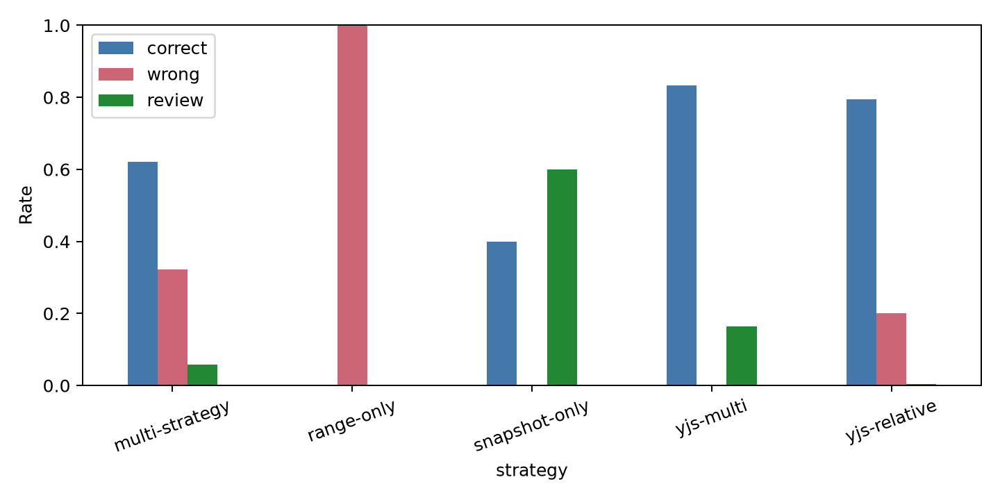

# 实验一：并发锚定

## 研究问题

在多人同时编辑、插入、移动和删除代码时，比较五种锚定策略保持原关联位置的能力，并记录错误迁移和请求人工复核的比例。

## 条件与样本量

结果来自冻结标签 `knowledge-exp-freeze-v2.1`，平台提交 `418a4ccc758de803efc5427bea0b0cd09cc26dc5`，数据提交 `ea11a85ed344c522fe3b63288cd8577c94fa6498`，manifest SHA-256 `3e536a77fb0724316e10fee1bf9d0d409f88caf57b13e0a7a189c9a339950137`，配置哈希 `1251aac44831146db92c9adb574fedb933cfcc2928164e6ec8f5ded51540d0ef`。该版本 Agent 与知识模型为 `minimax / MiniMax-M3`；本实验没有模型请求，Node.js 为 `v24.7.0`。冻结字段见 [freeze-v2.1.md](../freeze-v2.1.md)。本轮使用已有结果整理报告，没有重跑。

运行目录为 `experiments/knowledge/runs/E2-k7-formal-v21-m3/`。输入包含48个锚点、6类操作和5个随机种子，共1440条轨迹；每条轨迹评价五种策略，共7200次策略评价。可定位轨迹1200条，删除轨迹240条单独统计复核结果。

## 主要结果

| 策略 | 精确存活 | 精确存活率 | 边界容忍存活率 | 错误迁移率 | 复核请求率 |
|---|---:|---:|---:|---:|---:|
| range-only | 0/1200 | 0% | 0% | 100% | 0% |
| snapshot-only | 480/1200 | 40% | 40% | 0% | 60% |
| multi-strategy | 745/1200 | 62.08% | 67.92% | 32.17% | 5.75% |
| yjs-relative | 953/1200 | 79.42% | 79.75% | 20.08% | 0.50% |
| yjs-multi | 1001/1200 | 83.42% | 83.58% | 0.25% | 16.33% |

边界容忍定义为起点正确且终点行号误差不超过一行。主表各项分母均为1200条可定位轨迹；240条删除轨迹另行统计，其中 range-only 错误迁移240条，其余四种策略各请求复核240条。

## 操作类型矩阵

| 操作 | range-only | snapshot-only | multi-strategy | yjs-relative | yjs-multi |
|---|---:|---:|---:|---:|---:|
| insert-around | 0% | 100% | 100% | 100% | 100% |
| duplicate-before | 0% | 0% | 0% | 100% | 100% |
| interleaved | 0% | 0% | 100% | 99.17% | 97.50% |
| move-and-edit | 0% | 100% | 100% | 0% | 100% |
| three-members | 0% | 0% | 10.42% | 97.92% | 19.58% |
| delete | 错误100% | 复核100% | 复核100% | 复核100% | 复核100% |

移动类操作依靠快照信息补充位置。三人随机编辑中，yjs-multi 产生192/240次复核请求；同一批轨迹中 yjs-relative 有188条精确结果和4条错误结果。组合策略将错误迁移降到1条，同时增加了复核请求。该分布说明复核请求包含主动保留不确定结果的行为，不能直接等同于定位失败。

## 统计方法

置信区间使用10000次、以48个锚点为重采样单位的 bootstrap，种子为20261007。yjs-multi 相对 multi-strategy 的精确存活率差值为21.33个百分点，配对 bootstrap 95% CI 为[19.92, 22.75]个百分点。本实验使用构造操作集合，未进行总体显著性推断。

结果文件 SHA-256 为 `aff28c1ad7aab42e8eb3c94672c7cffed280e7987f2000687503669c33af0263`。完整操作分组的精确、容忍、错误、复核比例见 [anchors.csv](anchors.csv)，置信区间见 [cluster-bootstrap.json](cluster-bootstrap.json)。本轮新增模型请求0次、模型费用0元；原结果没有记录运行耗时。

## 失败与异常清单

- 没有运行失败或缺失轨迹。
- `three-members` 中 yjs-multi 的复核请求率较高，已按操作类型单独报告。
- 删除操作没有可定义的存活位置，单独报告复核和错误结果。

## 结论边界

yjs-relative 和 yjs-multi 在本构造集合中保持位置的比例最高，yjs-multi 的精确存活率为83.42%。结果只反映固定文本和六类操作，真实项目中的移动方式、编辑频率和参与人数分布需要另外采集。
