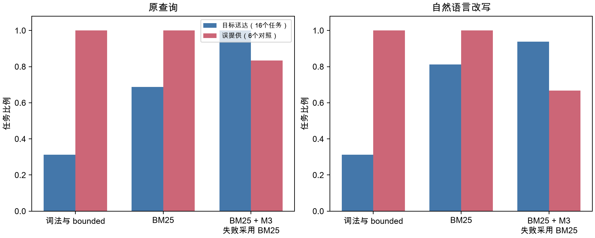

# 实验二：检索与送达

## 研究问题

比较现有词法检索、BM25 和 BM25 加 MiniMax-M3 重排能否提供目标卡片，并观察对照任务是否收到相关清单之外的卡片。本轮只读取历史结果，对 M3 失败的请求使用同一任务、同一查询变体的 BM25 结果，不发起模型请求。

## 条件与版本

使用 [knowledge-e3-freeze-v2.4.1](../freeze-e3-v2.4.1.md) 保存的220条记录。平台提交 `f55249d369a27aaea581189bbf69be67147a0325`，数据提交 `ea11a85ed344c522fe3b63288cd8577c94fa6498`；manifest SHA-256 为 `3e536a77fb0724316e10fee1bf9d0d409f88caf57b13e0a7a189c9a339950137`。解析后的通用配置哈希为 `ed17dd1be028bcb8d50bbca6dc21097da30b237684303512847bb723c2b5b1b3`。

- A：原词法计分与 bounded 排序。
- B：MiniSearch BM25+ 与 bounded 文件加分。
- C：B 召回前20张候选，由 `minimax / MiniMax-M3` 重排；失败时采用同一查询的 B 结果。

每种查询包含16个陷阱与6个对照。A、B 为确定性检索，各44条记录；C 为三次重复，共132条记录。查询包括原查询与自然语言改写。最终知识段预算统一为 top-5、每张800字符、总共4000字符。对照误提供定义为：提供的卡片中至少一张不在事前确认的相关清单内。任务多数按三次重复中至少两次计数，失败请求经 BM25 处理后参与多数计算。

## 主表

| 查询 | 条件 | 陷阱目标送达，逐次 | 陷阱目标送达，任务多数 | 对照误提供，逐次 | 对照误提供，任务多数 |
|---|---|---:|---:|---:|---:|
| 原查询 | A 词法与 bounded | 5/16，31.25% | 5/16 | 6/6 | 6/6 |
| 原查询 | B BM25 | 11/16，68.75% | 11/16 | 6/6 | 6/6 |
| 原查询 | C BM25+M3，失败采用 BM25 | 47/48，97.92% | 16/16 | 15/18 | 5/6 |
| 自然语言改写 | A 词法与 bounded | 5/16，31.25% | 5/16 | 6/6 | 6/6 |
| 自然语言改写 | B BM25 | 13/16，81.25% | 13/16 | 6/6 | 6/6 |
| 自然语言改写 | C BM25+M3，失败采用 BM25 | 44/48，91.67% | 15/16 | 13/18 | 4/6 |

原查询的 C 有4个陷阱请求采用 BM25，均提供了目标卡片。改写查询的 C 有1个对照请求采用 BM25，提供了相关清单外的卡片。M3 共失败5/132次，失败率3.79%。本表是 [freeze-v3.1 产品配置](../freeze-v3.1.md) 的离线对应数字。

## 配对检验

以16个陷阱任务为单位，C 使用任务多数结果。每种查询内的 A→B、B→C 两项比较使用精确 McNemar 与 Holm 校正。差值置信区间使用10000次配对任务 bootstrap，种子20261010。

| 查询 | 比较 | 送达增加/减少的任务 | 差值，百分点 | 95% CI，百分点 | 原始 p | Holm p |
|---|---|---:|---:|---:|---:|---:|
| 原查询 | B 相对 A | 7/1 | +37.50 | [6.25, 68.75] | 0.07031 | 0.125 |
| 原查询 | C 相对 B | 5/0 | +31.25 | [12.50, 56.25] | 0.06250 | 0.125 |
| 自然语言改写 | B 相对 A | 9/1 | +50.00 | [18.75, 75.00] | 0.02148 | 0.04297 |
| 自然语言改写 | C 相对 B | 2/0 | +12.50 | [0, 31.25] | 0.50000 | 0.500 |

自然语言改写中 B 相对 A 达到本比较组的显著性标准；其他比较为方向性结果。对照只有6个任务，误提供仅作描述，不报告检验。

## 活动文件与历史检索诊断

R1 的8个陷阱没有活动文件；B 在原查询送达4/8、改写送达6/8。R2 的8个陷阱从提示中的现有文件路径获得活动文件；B 两种查询均送达7/8。没有显式上下文或成员当前打开文件的样本。逐条活动文件与来源保存在补算附件中。

| 查询 | 条件 | 文本命中送达 | 文件相关送达 | 项目级兜底送达 | 活动文件为空时的总体送达 | 提示包含现有文件时的总体送达 |
|---|---|---:|---:|---:|---:|---:|
| 原查询 | A | 0/16 | 5/16 | 0/16 | 0/8 | 5/8 |
| 原查询 | B | 7/16 | 4/16 | 0/16 | 4/8 | 7/8 |
| 原查询 | C | 32/48 | 15/48 | 0/48 | 23/24 | 24/24 |
| 自然语言改写 | A | 0/16 | 5/16 | 0/16 | 0/8 | 5/8 |
| 自然语言改写 | B | 9/16 | 4/16 | 0/16 | 6/8 | 7/8 |
| 自然语言改写 | C | 29/48 | 15/48 | 0/48 | 21/24 | 23/24 |

来源使用已保存的 deliverySources，C 失败请求使用对应 B 的来源。来源标记描述产品选择路径，不能解释为各项排序因素的独立贡献。本批目标没有项目级兜底送达样本。

原 K5 的纯词法与 legacy 在16个陷阱的 Recall@5 均为0，诊断记录显示长查询使原词法计分大量达到上限，类型优先与同分次序控制排名；R1 又缺少活动文件信息。bounded 达到5/16，BM25 达到11/16。BM25 使用分词、词频、文档长度和匹配词覆盖信息，使不同候选保持不同分数。历史错误活动文件扰动中 bounded 的 Recall@5 从5/16变为0/16，BM25 保持11/16。历史 K5 的对照采用空相关集口径，单条件为30张卡片/6个查询，相关数值单独保留在 [E3 历史报告](../E3/report.md)，不与本表的相关清单口径混用。

## 失败与异常清单

| M3 请求 key | 校验失败原因 | 使用的 B 结果 |
|---|---|---|
| R1-T01-original-C-1 | selected 条目含未允许的 file 字段 | R1-T01-original-B-1 |
| R2-T04-original-C-1 | 响应没有 JSON 对象 | R2-T04-original-B-1 |
| R2-T05-original-C-3 | 响应没有 JSON 对象 | R2-T05-original-B-1 |
| R2-T08-original-C-2 | 响应没有 JSON 对象 | R2-T08-original-B-1 |
| R2-C02-paraphrase-C-1 | 响应没有 JSON 对象 | R2-C02-paraphrase-B-1 |

改写查询 `R1-T07` 的 C 目标送达为0/3，是唯一任务多数未送达的陷阱。C 原查询仍有15/18个对照请求发生误提供，送达能力与无关知识控制需要分别解释。

## 产物、耗时与费用

- 原始结果：`experiments/knowledge/runs/E3-delivery-v241-m3/results.jsonl`；SHA-256 为 `a03bfdcfd20a3722273ca69093b0e76f6c344e796708f79fa49750eff5249ae8`。
- [delivery-with-fallback.json](delivery-with-fallback.json)：132条最终选择、来源 key、失败原因、统计结果与输入文件哈希。
- [summarize.py](summarize.py)：补算与制图入口，读取原始结果并验证数量、唯一 key、模型、相关清单与 SHA-256。
- 本轮模型请求0次、模型费用0元；历史132次 M3 请求估算费用2.21926194元。

## 结论边界

C 在原查询达到16/16任务多数送达，在改写查询达到15/16。样本规模有限，C 相对 B 的配对检验未达到显著性标准；结果只支持构造任务中的送达观察。相关清单由一名审阅者在模型运行前确认，没有独立标注一致性数据。A→B 同时改变分词与计分，当前实验无法确定每项因素的单独贡献。Agent 收到知识后的行为由实验三评价。
