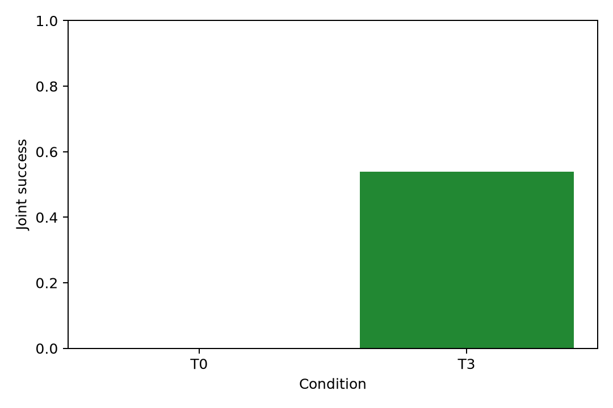
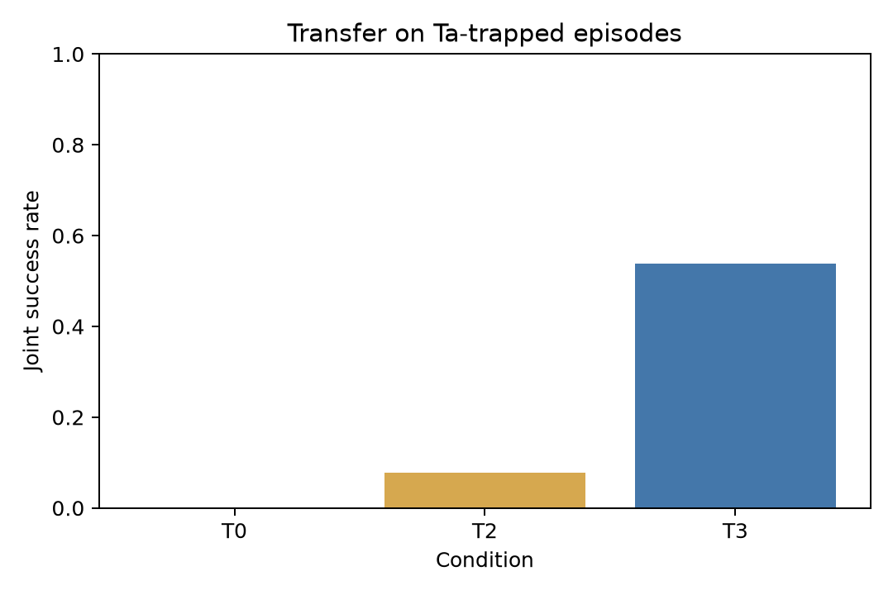

# 实验四：跨成员纠正迁移

## 研究问题

观察成员甲的 Agent 被纠正后形成的团队知识，是否能帮助成员乙的 Agent 避开相同陷阱。T0 不提供该卡片，T3 通过正常检索链路注入该卡片。每个共享 episode 只执行一次 Ta，再派生配对的 T0 与 T3 Tb。

## 冻结条件与样本

正式运行使用标签 `knowledge-exp-freeze-v3.1`，平台提交 `f0c20bd431024cd900243f73c27b9bbdcccaf947`，数据提交 `ea11a85ed344c522fe3b63288cd8577c94fa6498`，manifest SHA-256 为 `3e536a77fb0724316e10fee1bf9d0d409f88caf57b13e0a7a189c9a339950137`，配置哈希为 `1251aac44831146db92c9adb574fedb933cfcc2928164e6ec8f5ded51540d0ef`。Agent 与复盘、重排模型均为 `minimax / MiniMax-M3`，OpenCode 为 `1.18.31`，Node.js 为 `24.7.0`。

平台侧 `experiments/knowledge/k4.ts` 负责正式运行；数据仓库的 `tools/run-transfer.ts` 仅用于校准。6 对迁移任务各执行 3 个 Ta episode，共 18 个 episode；每个 episode 产生 T0 与 T3 两条 Tb 记录，共 36 条结果。36 个结果均已完成，结果键唯一，18 个 episode 均有 T0/T3 配对，且每对共享同一个 Ta `runId`。结果文件为 `runs/exp4-freeze-v31/results.jsonl`，SHA-256 为 `5d2be5d180a5e14f5c35b2539899c3971d06a11e7b31d7f31c434d92116a2d87`。

## 主要结果

| 样本 | 条件 | Tb 功能通过 | 陷阱避开 | 联合成功 | 复犯 | 目标卡片送达 |
|---|---|---:|---:|---:|---:|---:|
| 全部 18 个 episode | T0 | 17/18（94.44%） | 3/18（16.67%） | 3/18（16.67%） | 15/18（83.33%） | 0/18 |
| 全部 18 个 episode | T3 | 16/18（88.89%） | 12/18（66.67%） | 12/18（66.67%） | 6/18（33.33%） | 18/18 |
| Ta 实际踩坑 13 个 episode | T0 | 12/13（92.31%） | 0/13（0%） | 0/13（0%） | 13/13（100%） | 0/13 |
| Ta 实际踩坑 13 个 episode | T3 | 11/13（84.62%） | 7/13（53.85%） | 7/13（53.85%） | 6/13（46.15%） | 13/13 |

Ta 实际踩坑子集是主要比较口径。T0 与 T3 的联合成功差值为 53.85 个百分点，95% bootstrap CI 为 [30.58, 76.92]；精确 McNemar p=0.015625。全部 18 个 episode 的差值为 50 个百分点，95% CI 为 [27.78, 72.22]；精确 McNemar p=0.00390625。两项均以 episode 为配对单位。

跨属主 9 个 episode 的联合成功为 T0 0/9、T3 4/9；Ta 实际踩坑的跨属主子集为 8 个，T0 0/8、T3 3/8。自我纠正 9 个 episode 的联合成功为 T0 3/9、T3 8/9；Ta 实际踩坑的自我纠正子集为 5 个，T0 0/5、T3 4/5。这两组只作描述性报告，不单独进行显著性检验。

## 复盘质量与确认

18/18（100%）复盘草稿结构合法，17/18（94.44%）引用可解析，0/18 使用 fallback。18 个草稿全部通过人工确认流程，确认修改字段包括 `content`、`summary`、`title`、`type`、`appliesTo`，累计修改字符数为 22,180。18/18 记录 `captureBypassed=true`，18/18 记录 `naturallyTriggered=true`；这两项用于区分实验入口与产品自然触发观察。

T3 的 18 次注入均使用 `rankingSource=m3`，没有 BM25 回退。T0 的目标卡片不进入注入链路。确认到乙首次注入的延迟以 `reuseLatencyMs` 保存，逐条记录位于结果 JSONL。

## 费用与时间

| 项目 | MiniMax-M3 估算费用（元） |
|---|---:|
| Ta Agent 运行 | 6.2297 |
| Tb Agent 运行 | 12.8631 |
| 服务端复盘 | 0.8915 |
| T3 重排 | 0.0646 |
| 合计 | 20.0489 |

逐条记录中 T0/T3 的运行流程累计墙钟时间约 133.9 分钟，Agent 运行墙钟时间合计约 45.6 分钟。费用按 MiniMax-M3 标准价格估算，供应商实际账单未写入结果。

## 图表

## 失败与异常清单

正式 36 条结果没有运行器失败、额度失败、超时或判定器报错。一次早期尝试保留在 `raw/P01-episode-3-failure-20261017/`，其纠正后的项目测试未通过，未进入正式结果；重新运行同一 episode 后通过并纳入正式配对。该目录只作为运行审计证据，不计入样本。

## 迁移链路示例

可使用 `raw/P01-episode-1/` 查看完整链路：Ta 的批量库存事务陷阱、纠正原文、服务端复盘草稿、团队卡片、T3 的 `knowledge_injected` 事件与 Tb 判定。对应 T0/T3 结果分别为 `P01-T0-1` 与 `P01-T3-1`；T0 复犯，T3 避开陷阱并联合成功。

## 结论边界

在 Ta 实际踩坑的 13 个 episode 中，T3 的联合成功率高于 T0，配对精确 McNemar 检验通过；全部 episode 的结果方向一致。复盘结构质量较高，引用可解析率为 94.44%，仍有 1 个 episode 的引用校验未通过。结果来自固定迁移任务、固定确认规则和 MiniMax-M3，不能直接推断真人团队中的确认质量、阅读行为或长期复用效果。

## T2：模型原稿直接确认

T2 使用新冻结标签 `knowledge-exp-freeze-v3.2`，T2 实现提交为 `1b9cf09fa13988839ac4d2c958509a226a380972`，冻结标签提交为 `33787ee0bb57f54bf7911faded940c56446b1cfd`。数据提交、manifest 哈希和 `formal-v3.json` 配置哈希与 v3.1 相同。工具读取 `runs/exp4-freeze-v31/raw/` 中保存的18个 Ta episode、纠正记录和 `recap-quality.modelDraft`，原样导入并确认模型生成的卡片字段，再在独立 Tb 项目中使用与 T3 相同的 BM25 候选和 MiniMax-M3 重排。T0、T3 的结果文件没有被追加或改写。

18 个 T2 Tb 均完成，结果位于 `runs/exp4-t2-freeze-v31/results.jsonl`。每条记录包含 `draftHasRequiredTokens`、空的 `changedFields`、模型与重排用量、目标送达和判定结果，并补齐了与 T3 一致的 `captureBypassed`、`naturallyTriggered`、`recapCalls` 和 Ta 运行明细；这些字段从同一冻结 episode 的已保存记录复制并逐条核验，未重新运行模型。1 个原稿（P01-episode-3）引用校验未通过，仍按原样确认并运行，单独计入下表。

| 样本 | 条件 | Tb 功能通过 | 陷阱避开 | 联合成功 | 复犯 | 目标卡片送达 |
|---|---|---:|---:|---:|---:|---:|
| 全部18个 episode | T0 | 17/18（94.44%） | 3/18（16.67%） | 3/18（16.67%） | 15/18（83.33%） | 0/18（0%） |
| 全部18个 episode | T2 | 15/18（83.33%） | 4/18（22.22%） | 4/18（22.22%） | 14/18（77.78%） | 6/18（33.33%） |
| 全部18个 episode | T3 | 16/18（88.89%） | 12/18（66.67%） | 12/18（66.67%） | 6/18（33.33%） | 18/18（100%） |
| Ta 实际踩坑13个 episode | T0 | 12/13（92.31%） | 0/13（0%） | 0/13（0%） | 13/13（100%） | 0/13（0%） |
| Ta 实际踩坑13个 episode | T2 | 11/13（84.62%） | 1/13（7.69%） | 1/13（7.69%） | 12/13（92.31%） | 2/13（15.38%） |
| Ta 实际踩坑13个 episode | T3 | 11/13（84.62%） | 7/13（53.85%） | 7/13（53.85%） | 6/13（46.15%） | 13/13（100%） |

配对精确 McNemar 检验以 episode 为单位，Holm 校正同时调整全部18个和 Ta 实际踩坑13个 episode 的两项比较：

| 样本 | 比较 | 联合成功差值 | 95% bootstrap CI | 精确 p | Holm p |
|---|---|---:|---:|---:|---:|
| 全部18个 episode | T2 对 T0 | +5.56个百分点 | [0.00, 16.67] | 1.00000 | 1.00000 |
| 全部18个 episode | T3 对 T2 | +44.44个百分点 | [22.22, 66.67] | 0.0078125 | 0.03125 |
| Ta 实际踩坑13个 episode | T2 对 T0 | +7.69个百分点 | [0.00, 23.08] | 1.00000 | 1.00000 |
| Ta 实际踩坑13个 episode | T3 对 T2 | +46.15个百分点 | [23.08, 69.23] | 0.03125 | 0.09375 |

原稿完整包含迁移对 `requiredTokens` 的7/18条。按这一字段分组，完整18个 episode 中，原稿包含全部标识符的 T2 联合成功为4/7（57.14%），Ta 实际踩坑子集为1/4（25%）；原稿缺少至少一个标识符的11条中，联合成功为0/11，Ta 实际踩坑子集为0/9。T2 目标卡片送达为6/18；模型重排均完成，未发生回落。18/18 条确认记录的 `changedFields` 为空、`changedChars` 为0，说明 T2 没有采用预设确认规则补写卡片正文。

T2 对 T0 的差异没有达到显著水平。T3 对 T2 在两个口径下方向一致，全部 episode 比较经 Holm 校正后显著，Ta 实际踩坑子集为方向性结果。T3 的确认采用预先固定的改写规则，T2 反映自动复盘原稿直接确认后的效果，两者差异同时包含人工确认补充规则内容和检索送达差异，不能单独归因于某一个环节。

## T2 失败与异常清单

18 条运行均完成，未出现额度失败、超时、运行器失败或判定器报错。P01-episode-3 的原稿引用校验为失败，但按设计仍确认和运行。T2 有12/18条未送达目标卡片，其中候选记录主要显示 `selection-excluded`；这些记录仍保留在结果中，未从遵守指标中删除。T2 Agent 与 M3 重排合计估算费用为6.5641元（Agent 6.4627元、重排0.1015元），逐条墙钟时间合计约26.57分钟。统计与图来自 `runs/exp4-t2-freeze-v31/analysis/statistics/t2-statistics.json`。
